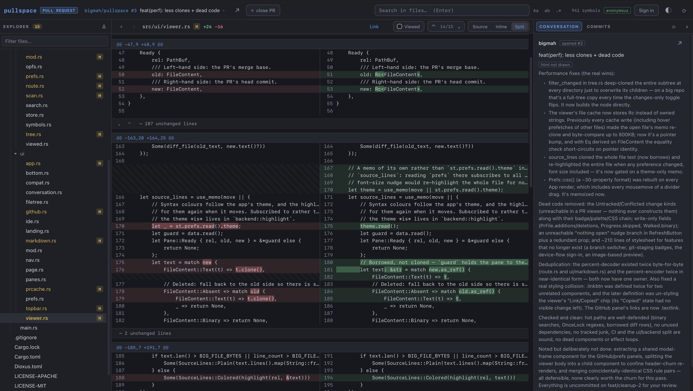

# pullspace

An IDE-style code reviewer written entirely in Rust and compiled to WASM

These days reading + approving pull requests is the bottleneck. The stock
diff viewer on github leaves alot to be desired, especially when compared
to the ergonomics of a local editor. 

Of course one can just checkout a particular PR's branch, and view in their
local editor, but this is often cumbersome due to having local changes staged. 

The path of least resistance today ends up looking like a million browser tabs
open, one for each specific thing we want to investigate. The browser makes 
sense as the place to review things in this way, but we pay the price with 
ergonomics and a cluttered brower tab list.

pullspace aims to be a solution to this. A better browser based code review UX.



Features:

* Open many reviews/sessions in a single browser tab
* IDE-style code review features (file tree, goto def, view refs, search, etc)
* Native HTML rendering 
* No sign-in needed (PAT required for private repos)
* Source code never leaves the browser. Like a local IDE but compiled to WASM. 
* Review from the diff: comment on any line GitHub's diff has, reply to
  threads, hold comments for a review, and submit it with a comment, an
  approval or a request for changes (needs a token with write access to pull
  requests)
* Summaries: your coding agent keeps a map of the repository in `.pullspace/`,
  one page per directory explaining how it works, and writes a reviewer's guide
  for every PR. pullspace shows each page next to the code, flags pages that
  are out of date, and shows how a PR changed the explanation. See
  [SUMMARIES.md](SUMMARIES.md).

Upcoming:

* better support as a browser exension (one click on a PR to open pullspace)


## Embedded

pullspace can also review files that a host page hands it instead of GitHub: a local
checkout's working tree against `HEAD`, say. Opened in a same-origin frame as
`/pullspace/?embed`, it asks its parent for each side's files (as git blob hashes) and for
blob contents over `postMessage`, and hides everything GitHub-specific. Its bar becomes a
pane's header, the explorer opens on the files that changed, and it lays itself out for
the width the host gives it: in a narrow frame (beside a conversation, on a phone) the
explorer folds away behind a button and diffs are one column. The host can ask it to show
a file, and **Ask** hands the host what the reader is looking at: a selection, a line or
the file.

A host depends on the `pullspace-embed` crate (`crates/embed`): it carries the built bundle
(checked in under `crates/embed/dist`, so the host needs no wasm toolchain), the files to
serve and how, and the protocol's message types. After changing pullspace, run
`crates/embed/build.sh` and commit `dist/` with the change.
[tamale](https://github.com/bigmah/tamale)'s web UI uses it for its review panel.

## Running it
```sh
cargo install dioxus-cli --version 0.6.3 --locked   # once, for `dx`

dx build --platform web --release
```

